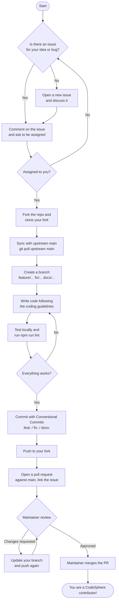

# CodeSphere

### Every great developer started with one line of code. Your next one could ship here.

**Learn together. Build together. Grow together.**

CodeSphere is where curiosity turns into code. We're a student-driven community at Alipurduar Government Engineering and Management College: a place where your first "Hello, World" gets the same cheer as a winning hackathon project.

Here, no question is too basic and no idea is too big. Seniors guide juniors, beginners become mentors, and late-night debugging sessions turn strangers into teammates. We believe great developers aren't born. They're built, one bug, one commit and one collaboration at a time.

This project is our community in code. Every page was shaped by someone who once wondered if they were "good enough" to contribute. Now it's your turn to leave your mark.

Contributions from anyone are welcome: students, first-time open source contributors and experienced developers alike. Read [Getting Started](#getting-started) to run the project, then [Contributing](#contributing) before opening a pull request.

---

## Table of Contents

- [Tech Stack](#tech-stack)
- [Project Structure](#project-structure)
- [Getting Started](#getting-started)
- [Community Modules](#community-modules)
- [XP, Badges & Levels](#xp-badges--levels)
- [Contributing](#contributing)
- [Code of Conduct](#code-of-conduct)
- [Security](#security)
- [Contact](#contact)
- [License](#license)

---

## Tech Stack

| Part | Technologies |
| --- | --- |
| Frontend (`client/`) | React, Vite, React Router, Bootstrap, Bootstrap Icons, TinyMCE, DOMPurify |
| Backend (`server/`) | Node.js, Express, MongoDB (Mongoose), JWT, bcrypt, Multer, sanitize-html |
| Services | Brevo (OTP and contact emails), ImageKit (image uploads), TinyMCE Cloud (rich-text editor) |

## Project Structure

```
CodeSphere/
├── client/                 # React frontend (Vite)
│   ├── public/             # Static files (videos, icons)
│   └── src/
│       ├── components/     # Reusable UI (Navbar, Footer, Hero, ...)
│       ├── context/        # React context (AuthContext)
│       ├── css/            # One stylesheet per page/component
│       ├── lib/api.js      # API helper (uses VITE_API_URL)
│       └── pages/          # Route pages (Register, Login, Admin, Events, ...)
└── server/                 # Express backend
    ├── config/             # Service clients (ImageKit, ...)
    ├── middleware/         # Auth and other middleware
    ├── models/             # Mongoose models
    ├── routes/             # API routes (auth, events, users, contact, core members)
    ├── scripts/            # One-off scripts (createAdmin.js)
    └── server.js           # Entry point
```

---

## Getting Started

### Prerequisites

- [Node.js](https://nodejs.org/) 20 or newer (LTS recommended) and npm
- [Git](https://git-scm.com/)
- A MongoDB database: a free [MongoDB Atlas](https://www.mongodb.com/atlas) cluster or a local MongoDB install
- Free accounts for the services you need to test:
  - [Brevo](https://www.brevo.com/) for sign-up OTP emails and the contact form
  - [ImageKit](https://imagekit.io/) for image uploads
  - [TinyMCE](https://www.tiny.cloud/) for the admin rich-text editor
  - [Judge0 on RapidAPI](https://rapidapi.com/judge0-official/api/judge0-ce) to check Playground challenge answers

### 1. Fork and clone

Fork the repository on GitHub, then:

```bash
git clone https://github.com/<your-username>/CodeSphere.git
cd CodeSphere
git remote add upstream https://github.com/Toumik-Haque/CodeSphere.git
```

### Quick setup (recommended)

One command does steps 2 and 3 for you:

```bash
node setup.js
```

It installs dependencies for `server/` and `client/` and creates both `.env` files from the examples. It also generates `JWT_SECRET` and `OTP_HASH_SECRET` and lists any values you still need to fill in. It's safe to run again: existing values are never overwritten, and new keys from `.env.example` are added. Then fill in the listed values and jump to [step 4](#4-run-the-app).

Prefer doing it by hand? Follow steps 2 and 3 below.

### 2. Install dependencies

The frontend and backend are separate npm projects, so install both:

```bash
cd server && npm install
cd ../client && npm install
```

> Run `npm install` again in both folders whenever you pull new changes. A `Cannot find module` / `Failed to resolve import` error almost always means a new package was added.

### 3. Set up environment variables

Copy the example files and fill in your own values:

```bash
cp server/.env.example server/.env
cp client/.env.example client/.env
```

**`server/.env`**

| Variable | Description |
| --- | --- |
| `PORT` | Port for the API (default `5000`; the client expects `5000`) |
| `MONGODB_URI` | MongoDB connection string |
| `JWT_SECRET` | Long random string used to sign login tokens |
| `CLIENT_URL` | Frontend URL, `http://localhost:5173` in development |
| `IMAGEKIT_PRIVATE_KEY` | ImageKit private API key |
| `BREVO_API_KEY` | Brevo API key (v3) |
| `BREVO_SENDER_EMAIL` | A sender email verified in your Brevo account |
| `BREVO_SENDER_NAME` | Display name for outgoing emails |
| `OTP_HASH_SECRET` | Long random string used to hash OTP codes |
| `CONTACT_RECEIVER_EMAIL` | Inbox that receives contact-form messages |
| `JUDGE0_URL` | Judge0 API used to check Playground challenge answers (default: RapidAPI's Judge0 CE; or your self-hosted Judge0) |
| `JUDGE0_API_KEY` | RapidAPI key for Judge0 (leave empty for a self-hosted Judge0 without auth) |
| `NEWS_FETCH_HOURS` | How often (hours) active Tech News feeds are fetched (default `24`) |
| `NEWS_SCHEDULER` | Set to `off` to disable automatic feed fetching and scheduled digest announcements |

**`client/.env`**

| Variable | Description |
| --- | --- |
| `VITE_TINYMCE_API_KEY` | TinyMCE Cloud API key |
| `VITE_API_URL` | Backend API URL (default `http://localhost:5000/api`); set it to your deployed API URL in production |

To generate a random secret:

```bash
node -e "console.log(require('crypto').randomBytes(48).toString('hex'))"
```

> **Never commit `.env` files.** They are already in `.gitignore`. If you add a new variable, add it (with an empty value) to the matching `.env.example` and to the table above.

### 4. Run the app

Use two terminals:

```bash
# Terminal 1: backend on http://localhost:5000
cd server
npm run dev

# Terminal 2: frontend on http://localhost:5173
cd client
npm run dev
```

Open http://localhost:5173.

### 5. Create an admin account (optional)

To use the admin dashboard, create an admin user in your database:

```bash
cd server
node scripts/createAdmin.js
```

It asks for a name, email and password (8–12 characters).

### Useful scripts

| Folder | Command | What it does |
| --- | --- | --- |
| `client` | `npm run dev` | Start the Vite dev server |
| `client` | `npm run build` | Build for production into `client/dist` |
| `client` | `npm run preview` | Preview the production build |
| `client` | `npm run lint` | Run ESLint |
| `server` | `npm run dev` | Start the API with auto-restart (nodemon) |
| `server` | `npm start` | Start the API without auto-restart |
| `server` | `node scripts/generateDebugBugs.js` | Rebuild the Debugging Arena question bank (`server/data/debugBugsGenerated.json`) |
| `server` | `node scripts/syncBadges.js` | Award existing students the badges they already qualify for (safe to re-run) |
| `server` | `node scripts/seedReverseChallenges.js` | Load the 12 starter Reverse Coding challenges (add `--draft` to keep them unpublished) |
| `server` | `node scripts/seedNewsSources.js` | Add the suggested Tech News sources (inactive until an editor tests and enables them) |

### Troubleshooting

| Problem | Fix |
| --- | --- |
| `Cannot find module ...` or `Failed to resolve import ...` | Run `npm install` in that folder, then restart the dev server. |
| OTP / contact email not sent, Brevo says `unrecognised IP address` | In Brevo, go to **Security → Authorised IPs** and add your IP or turn the restriction off for development. |
| OTP fails with `undefined` errors | A variable is missing from `server/.env`. Compare it with `server/.env.example`. |
| Frontend can't reach the API | Make sure the server is running and `VITE_API_URL` in `client/.env` points to it, then restart the client. |
| Push rejected: `Push cannot contain secrets` | A commit contains a key. Remove it from the commit (not just in a later commit), and change the key in the provider's dashboard. |

---

## Community Modules

| Module | Students | Staff page |
| --- | --- | --- |
| **Discussion Forum** (`/forum`) | Ask, share and discuss in 8 categories; replies, reactions, accepted answers, follow, save, report | `/admin/forum`: report queue, hide/remove/lock/pin/move, pause posting, audit trail |
| **Reverse Coding** (`/reverse-coding`) | Read a program's behaviour, write code that reproduces it, Run on samples, Submit against hidden tests | `/admin/reverse-coding`: author challenges, validate the reference solution, publish or schedule |
| **Weekly Tech News** (`/news`) | A curated weekly digest with original summaries and links to sources; search, archive, save | `/admin/news`: sources, review queue, approve stories, build and publish digests |

All three use your normal CodeSphere account, send in-app notifications (bell icon; students can mute types) and feed XP and badges.

**Good to know**
- **Reverse Coding needs Judge0.** Student code only ever runs in the Judge0 sandbox, never on the web server. Until `JUDGE0_API_KEY` (or a self-hosted `JUDGE0_URL`) is set, students can read challenges and draft code, but Run, Submit and Validate are disabled.
- **Tech News is human-reviewed.** Feeds only create candidates; a story is published only after an editor writes a summary and approves it inside a digest. Test each suggested source and check the publisher's terms before enabling it.
- **Forum content is plain text.** Posts are stored as text and shown with a small safe formatting set (code blocks, inline code, bold, links), so user content can never inject HTML.
- **Staff roles:** for now, admins act as moderators, news editors and challenge editors.

---

## XP, Badges & Levels

Students earn **XP** from the daily Debugging Arena bug, the coding challenges and Reverse Coding, which decides their **level** (🥚 Newbie to 👑 CodeSphere Legend) and their place on the Leaderboard.

**Badges** (46 in 10 groups) reward progress. They are saved the moment they're earned and are never taken away, so missing a day never costs a student anything.

| Type | How it's earned |
| --- | --- |
| Automatic | Tracked activity: bugs fixed, best streak, XP, events attended (marked by admins) |
| Self-reported | Coding challenges (while answer checking is off) and a 100% profile, labelled as such |
| Community | Awarded by admins from the Admin dashboard (Mentor, Builder, Collaborator, Speaker, Designer) |
| Coming soon | Open-source badges, shown locked until pull requests are tracked |

Students see their level, badges, progress and a showcase of up to 3 pinned badges on their **Profile**, and a toast pops up whenever they unlock one.

**Adding a badge:** add an entry to `server/data/badges.js`. For automatic badges, use a `metric` from `buildStats()` in `server/utils/badges.js` (or add one there) and a `target`. Never change an existing badge `id`, because earned badges are stored by id. Then run `node scripts/syncBadges.js` to award it to students who already qualify.

---

## Contributing

These rules draw on common practice from open source communities such as the Contributor Covenant, Conventional Commits, GitHub's open source guides and Hacktoberfest's quality rules.

### Ways to contribute

- Fix bugs and report new ones
- Build features listed in the issues
- Improve the UI, accessibility, responsiveness or performance
- Improve documentation, including this README
- Review other people's pull requests

### Workflow



1. **Find or open an issue.** Check [existing issues](https://github.com/Toumik-Haque/CodeSphere/issues) first. For anything bigger than a small fix, open an issue and discuss it before you write code.
2. **Ask to be assigned.** Comment on the issue and wait for a maintainer to assign it to you. Do not work on an issue assigned to someone else. If an assigned issue has no activity for 7 days, maintainers may reassign it.
3. **Sync your fork:**
   ```bash
   git checkout main
   git pull upstream main
   ```
4. **Create a branch** from `main`, named by type:

   | Type | Example |
   | --- | --- |
   | Feature | `feature/event-registration` |
   | Bug fix | `fix/otp-resend-timer` |
   | Docs | `docs/setup-guide` |
   | Styling / UI | `style/navbar-mobile` |
   | Refactor | `refactor/auth-routes` |
   | Maintenance | `chore/update-deps` |

5. **Make your changes** following the [coding guidelines](#coding-guidelines).
6. **Test locally.** Run the app, try your change, and run `npm run lint` in `client/`.
7. **Commit** using [Conventional Commits](#commit-messages).
8. **Push and open a pull request** against `main`:
   ```bash
   git push origin <your-branch>
   ```

### Commit messages

Follow [Conventional Commits](https://www.conventionalcommits.org/):

```
<type>: <short summary in present tense>
```

| Type | Use for |
| --- | --- |
| `feat` | A new feature |
| `fix` | A bug fix |
| `docs` | Documentation only |
| `style` | CSS / visual changes, formatting |
| `refactor` | Code change that neither fixes a bug nor adds a feature |
| `perf` | Performance improvement |
| `chore` | Dependencies, config, tooling |

Examples:

```
feat: add search to events page
fix: return focus to menu button when mobile drawer closes
docs: add ImageKit setup to README
```

Keep each commit focused on one thing. Don't mix unrelated changes.

### Pull request rules

- **One pull request per issue or feature.** Keep it small enough to review.
- **Link the issue** in the description, for example `Closes #12`.
- **Explain what changed and why.** For UI changes, add before/after screenshots, including mobile.
- **Keep your branch up to date** with `main` and resolve conflicts yourself.
- **Don't commit** `.env` files, API keys, passwords, `node_modules/`, `dist/` or large files you don't need. Compress media before adding it (aim for under 5 MB per video).
- **Only change `package-lock.json`** when you actually add, remove or update a dependency, and say so in the PR.
- **Respond to review comments.** Pull requests with no response for 14 days may be closed.
- **A maintainer must approve** every PR before it is merged. Don't merge your own PR.

**PR checklist**

- [ ] The app runs locally with no new errors in the browser console or server log
- [ ] `npm run lint` passes for the files I changed
- [ ] The UI works on mobile and desktop
- [ ] No secrets or `.env` files are included
- [ ] New environment variables are added to `.env.example` and this README
- [ ] The PR links its issue and includes screenshots for UI changes

### Coding guidelines

- **Match the existing style.** Use functional React components with hooks, and give each page or component its own stylesheet in `client/src/css/`.
- **Use clear names.** Prefer descriptive variable and function names over comments that explain unclear code.
- **Accessibility matters.** Use semantic HTML, `alt` text on images, labels on form fields, and make sure everything works with a keyboard.
- **Security:**
  - Sanitize any user-provided HTML: DOMPurify on the client, sanitize-html on the server.
  - Validate input on the server, not only in the browser.
  - Never log passwords, tokens or OTP codes.
  - Keep all keys in environment variables.
- **Dependencies:** don't add a new package without a good reason. Explain why it is needed in your PR.
- **Remove leftovers.** Delete unused code, `console.log` debugging and commented-out blocks before you open the PR.

### Reporting bugs

Open an issue that includes:

- What you expected and what actually happened
- Steps to reproduce
- Screenshots or console errors, if any
- Browser, device and operating system

### Suggesting features

Open an issue that describes the problem the feature solves, your proposed solution and any alternatives you considered.

### Not accepted

To keep the project quality high, these will be closed without merging, as in Hacktoberfest's spam rules:

- Pull requests that only change whitespace, fix one typo in code, or rename things without a reason
- Automated or AI-generated changes submitted without being understood, tested and explained by the contributor
- Pull requests copied from another contributor's work
- Changes that add unrelated features, tracking, ads or promotional links
- Repeated low-effort PRs made only to increase contribution counts

Repeated spam may lead to being blocked from the repository.

---

## Code of Conduct

This project follows the spirit of the [Contributor Covenant](https://www.contributor-covenant.org/version/2/1/code_of_conduct/). By taking part, you agree to:

- Be respectful, welcoming and patient, especially with beginners
- Give and accept constructive feedback gracefully
- Focus on what is best for the community
- Credit other people's work

These are not tolerated:

- Harassment, insults or discriminatory language of any kind
- Personal or political attacks, trolling
- Publishing other people's private information
- Any conduct that would be inappropriate in a professional or college setting

Report unacceptable behaviour to **codesphere@agemc.ac.in**. Maintainers will review every report, keep it confidential, and may warn, temporarily ban or permanently remove anyone who breaks these rules.

---

## Security

**Do not report security vulnerabilities in public issues.** Email **codesphere@agemc.ac.in** with the details and steps to reproduce. Maintainers will respond as soon as possible and credit you once it is fixed, if you want.

If you accidentally commit a secret (API key, password, database URL), tell a maintainer right away and change the key in that service's dashboard. Deleting it in a new commit is not enough, because it stays in git history.

---

## Contact

- **Email:** codesphere@agemc.ac.in
- **Address:** Alipurduar Government Engineering and Management College, West Bengal, 736202
- **Issues:** https://github.com/Toumik-Haque/CodeSphere/issues

---

## Contributors

Thanks to everyone who has contributed to CodeSphere!

<a href="https://github.com/Toumik-Haque/CodeSphere/graphs/contributors">
  
</a>

---

## License

CodeSphere is open source under the [MIT License](LICENSE). By contributing, you agree that your contributions are licensed under the same license.
